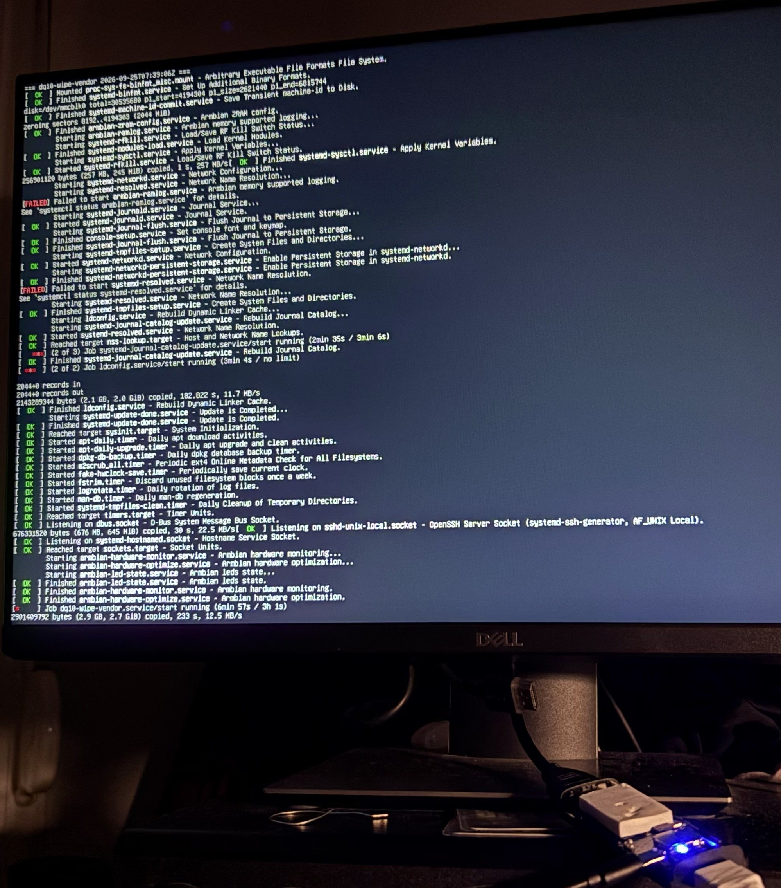
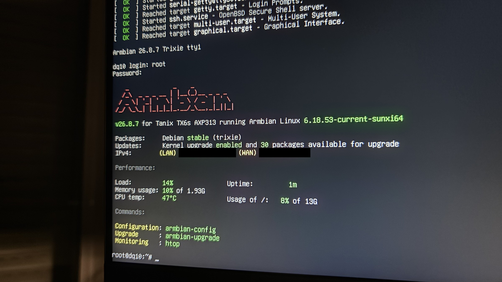

# Mainline U-Boot + Armbian for the DQ10 TV stick (Allwinner H616/H618 "athena_p1")

A source-and-documentation port that replaces the factory Android of one specific cheap Android TV stick with **mainline U-Boot v2026.10 + TF-A v2.15.0** and an **Armbian 6.18.53** root file system, flashed to the internal eMMC from a PC over USB (FEL mode, no soldering, no serial console).

| | |
|---|---|
| Board | "DQ10" Android TV stick, Allwinner board name `athena_p1` (platform `sun50iw9p1`) |
| SoC | Allwinner H618-class (the vendor reports H618; mainline treats H313/H616/H618 alike), 4x Cortex-A53, FEL USB id `1f3a:efe8` |
| Memory / storage | 2 GiB LPDDR3, 16 GB eMMC (15,634,268,160 bytes), microSD slot |
| PMIC | AXP313A (the vendor calls it AXP1530), I2C 0x36 on R_I2C |
| Wi-Fi / Bluetooth | AIC8800D80 on SDIO (`c8a1:0082` and `c8a1:0182`) |
| Ports | HDMI, one USB-A port, a power input (own adapter), a button used to enter FEL |

> **Read this before you do anything.** Flashing replaces the bootloader of a device that has **no serial console and no vendor recovery path**. The procedure is designed so that an interrupted write leaves the stick in FEL (recoverable over USB), and it was completed successfully on one unit, but there is one state without a software way back (a valid SPL that hangs). You use this at your own risk. There is no warranty (GPL-2.0-or-later, section 11 and 12).

## Do you have this board?

All of the following should hold; the first two are the quickest checks.

1. **Android properties** (if the factory Android still runs and you can use `adb`): `getprop ro.product.model` = `DQ10`, `ro.product.name` = `athena_p1`, `ro.boot.hardware` = `sun50iw9p1`, `ro.soc.model` = `H618`.
2. **FEL identity:** with the stick in FEL mode (unplug the power adapter, hold the button, plug the adapter in, keep holding about 3 s; USB A-to-A cable to the PC) `lsusb` shows `1f3a:efe8` and `sunxi-fel ver` reports an H616-family SoC (`soc 0x1823`). Remove any microSD card first.
3. **DRAM test:** `bash scripts/fel-dram-test.sh` (writes nothing to the eMMC, RAM only) ends with `DRAM PATTERN TEST PASSED`. If it fails, **stop**: the DRAM parameters in this port are decoded from this board's vendor boot0 and are not valid for other H616/H618 sticks.
4. **Wi-Fi chip:** a vendor `dmesg` / `lsmod` shows `aic8800d80`, SDIO ids `c8a1:0082`/`c8a1:0182`.
5. **eMMC size:** exactly 15,634,268,160 bytes (the flasher and `ums-flash.sh` refuse any other size).

**If your eMMC size differs, this port does not support it as is.** The size is hard-coded in: `scripts/flasher-init.sh` (`EMMC_BYTES`, `EMMC_SECTORS`), `scripts/ums-flash.sh` (`SZ`, `TOTAL_SECTORS`, `count=14910`), `scripts/build-image.sh` (`TOTAL`), `scripts/make-hash-list.sh` (`EXPECT`), `scripts/device/dq10-commit.sh` (the `blockdev --getsize64` check), `tests/test-ums-flash.sh` and `tests/test-flasher-init.sh`, and in the layout numbers of `docs/FLASH-PLAN.md` (the sector 30535680 / 30212096 figures and the 14910 MiB). A different size probably means a different board revision: check the DRAM first (step 3 above). Do not just edit the constants.

Other "H616/H618 TV boxes" with different DRAM, PMIC or Wi-Fi wiring are **not** supported by these files. Do not flash them.

## Status

Proven on **one unit, on 2026-10-30**:

| First boot: the one-time vendor-area wipe service running (blue LED = PH6) | Armbian 6.18.53 login on the stick (IP addresses blacked out) |
|---|---|
|  |  |

* The BROM-to-FEL path works (button + power), the decoded vendor DRAM parameters work with the mainline LPDDR3 code (2 GiB present, no aliasing), and the BROM dumped from the unit **matches the published NBROM** (`smaeul/sunxi-blobs`, sha256 `da649502bc3fc09fcbde1d50beaaddbf0e9390e0c7fcaacb86fac399a9188a1a`, i.e. the normal, non-secure-boot ROM).
* Route L (below) completed: the eMMC user area was zeroed, the Armbian root file system and the new U-Boot head were written, and the read-back verification finished with `ALL VERIFIED` (exit code 0).
* The stick **booted Armbian 6.18.53** (`6.18.53-current-sunxi64`) from the eMMC and **Wi-Fi (AIC8800D80) works**.
* Hardware results from the earlier RAM-only and read-only sessions are in `docs/BUILD-NOTES.md` sections 17, 19 and 21 (DRAM test, keyed-autoboot reach test, the USB gadget enumerating from a cold button entry, an HDMI text console and an AIC8800 scan from a RAM-booted Linux).

Not claimed, not verified here: Bluetooth, audio, IR receiver, the second PH7 LED polarity, the microSD slot, other USB controllers, CPU frequency scaling beyond the safe default bin, HDMI beyond the console, hardware video decoding. Treat the DT as a first working version. `docs/FLASH-PLAN.md` and `docs/BUILD-NOTES.md` were written **before** the first flash, so passages that say "not executed" describe that earlier state.

Not in the repository on purpose: any unique identifier of the original unit (SoC ID words 1-3, eMMC CID/serial, MAC address, Android serial, vendor-eMMC hashes), the owner's SSH key, and any binary. You make your own backup and your own hash list (`docs/FLASH-PLAN.md`, "Your own backup and hash list"; `scripts/make-hash-list.sh`).

## Quick start (Route L, summary)

Route L = **FEL (button) -> small Linux flasher in RAM -> the eMMC is exported as a USB disk -> `scripts/ums-flash.sh` on the PC**. The vendor Android never runs. Full step list with failure table: `docs/FLASH-PLAN.md`, Part 1 (steps L0-L9).

Needs: a PC with Linux (or Windows + WSL2 + `usbipd-win`), `sunxi-tools` (`sunxi-fel` 1.4.2), a **USB A-to-A cable**, an HDMI display (the status screen and one LED are the only feedback), the stick on its **own power adapter**, no microSD inserted.

1. **Get the binaries: you build them yourself.** Binaries are not in git, and **no prebuilt image or Release is published**: every built image contains the AIC8800 Wi-Fi firmware blobs (via the Radxa package) and their redistribution terms were **not audited**. Any future Release would have to be cleared on that point first and built **without** `AUTHORIZED_KEY`. Build with `docs/BUILD-NOTES.md` section 13 (U-Boot + TF-A, the DTB from `dts/`, `sudo scripts/build-image.sh`, `sudo scripts/build-flasher.sh`). To log in over SSH build with `AUTHORIZED_KEY=/path/to/your_key.pub sudo -E scripts/build-image.sh` (a **public** key; the script refuses private keys and non-key files; without it no key is baked in and the image has console login only). Your own build has its own image hashes: the maintainer hashes quoted in `docs/FLASH-PLAN.md` are for the reference build only; `image/SHA256SUMS` from your build is the reference for your image.
2. **Optional:** `scripts/set-wifi.sh` bakes Wi-Fi credentials into a copy of the root file system.
3. **L1-L2:** enter FEL, `bash scripts/fel-dram-test.sh` (RAM only).
4. **L3:** the U-Boot reach test (`flasher/reach-*.uenv`), RAM only.
5. **L4:** load the flasher **read-only** (`flasher/flasher-ro.uenv`), bind the gadget `1d6b:0104` with `usbipd bind --force`, attach it to WSL, then in this order: dry run with `--skip-identity` (read-only; you have no identity hash yet), **your backup** (verified), **your hash list**, `--compare-hashes` must say `COMPARE OK`, and a dry run **without** `--skip-identity` must pass (`docs/FLASH-PLAN.md`, L4).
6. **L5-L6:** only with `BACKUP-GZ-OK` and `COMPARE OK` in hand: load the flasher **writable** (`flasher-rw.uenv`), run `bash scripts/ums-flash.sh $DEV` (dry run), then `bash scripts/ums-flash.sh $DEV --yes-wipe-everything`; the exit code must be 0 (`ALL VERIFIED`). Never use `--skip-identity` on a first write (only to repeat after an interrupted run of the script).
7. **L7-L8:** detach, unplug the adapter and the A-A cable, power up **without** the button. First boot is slow (10-20 min): a service zero-fills the free ranges that held the vendor system.

If anything is unclear, stop; every step before L6 is read-only on the stick.

## Repository layout

```
README.md, LICENSE                 this file; GPL-2.0 text
docs/FLASH-PLAN.md                 runbook (Route L = main route; ADB route = fallback; restore; verification checklist)
docs/BUILD-NOTES.md                pinned sources and hashes, decoded DRAM/PMIC tables, DT decisions, risks, changelog
docs/AUDIT-OPUS*.md                the three independent audits and what was changed because of them
docs/MALWARE-IOCS.md               what was found in the vendor firmware (hashes and host names only, no samples)
scripts/                           build-image.sh, build-flasher.sh, build-fel-bundle.sh, flasher-init.sh (the flasher's /init),
                                   ums-flash.sh (the writer/verifier), make-hash-list.sh, fel-dram-test.sh, set-wifi.sh,
                                   device/ (ADB-fallback scripts that run ON the stick)
dts/                               board DT (Linux) and the flasher variant (USB device mode)
uboot/                             defconfig, local U-Boot DTs, resolved full .config; uboot/recovery/ = the historic Route F variant
flasher/, felbundle/               uEnv scripts and run notes for loading the flasher / the test bundle into RAM over FEL
diag/                              the FEL diagnostics D1-D5 and runner scripts used during bring-up
tests/                             test-ums-flash.sh (loop files only), test-flasher-init.sh (fake sysfs)
image-overlay/                     files that build-image.sh installs into the root file system (first-boot wipe service, sshd drop-in)
```

Not in git: `image/`, the kernel `Image`, DTBs, initramfs, SPL/U-Boot binaries, `dl-*` downloads (the docs name each by URL, pinned commit and sha256), `tools-sunxi-fw`, and the working logs. Some passages of the docs refer to those paths as they existed in the original working tree.

## Tests

Run as root on a Linux host (WSL works); both use loop files and a fake sysfs, never a real device:

```
bash tests/test-flasher-init.sh      # 60 checks on the flasher's /init logic
bash tests/test-ums-flash.sh         # guards, identity/hash-list sources, full 15 GB loop write + verify, error paths; needs ~16 GiB in /tmp
```

## Security note on the vendor firmware

The factory Android on the observed unit carried a root remote-command agent and other persistence (`docs/MALWARE-IOCS.md`). That is why the plan zeroes the whole eMMC and never runs the vendor system. If you keep a backup, keep it private and never execute anything from it.

## License

Our own files (scripts, tests, diagnostics, documentation, defconfigs, uEnv scripts, image overlay) are licensed under **GPL-2.0-or-later**; the full GPL-2.0 text is in `LICENSE`. The device-tree sources keep the SPDX identifier they carry: the board DT and the flasher DT are `GPL-2.0+ OR MIT` (derived from the Linux Tanix TX1 DT, Copyright 2024 Arm Ltd.); the U-Boot DTs are `GPL-2.0+`.

Third-party components that this repository only references (they are not in git; check each upstream for its exact terms before you redistribute a built image):

* U-Boot (GPL-2.0-or-later), Linux kernel and Armbian build framework (GPL-2.0), TF-A (BSD-3-Clause), BusyBox (GPL-2.0), sunxi-tools (GPL-2.0).
* The Armbian image itself, Debian packages in it, and the Radxa `aic8800` driver and firmware. The AIC8800 firmware blobs are **not included in this repository**, and their redistribution terms are **unknown / not audited** (the only note on this is in `docs/BUILD-NOTES.md` section 8.3, which records that the terms were not audited). **For that reason no prebuilt image is published**; a built image contains those blobs.
* The published BROM dumps (`smaeul/sunxi-blobs`) are used only as a reference for a hash comparison.

## Credits

The Linux-sunxi community and the U-Boot / TF-A maintainers (H616 DRAM driver, AXP313 support, the Tanix TX1 board this port is derived from); Armbian (kernel, display-pipeline patches, base image); `apritzel/sunxi-fw` (DRAM parameter layout); `smaeul/sunxi-blobs` (BROM reference); the `radxa-pkg/aic8800` maintainers; `usbipd-win`. The port was prepared with AI-assisted builds and independent AI audits (`docs/`), then verified on hardware by the unit's owner.

This project is not affiliated with Allwinner, the stick's vendor, Armbian, Radxa or Anthropic.
